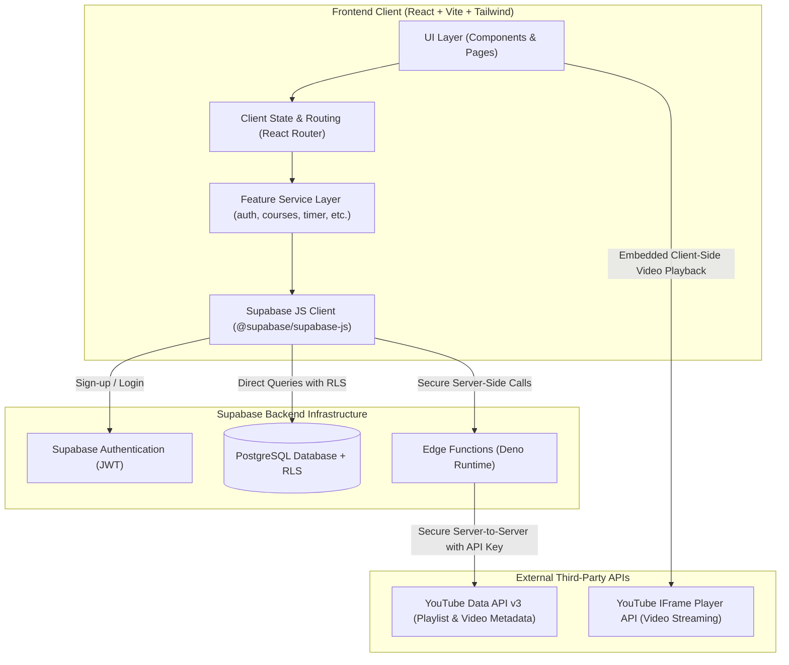
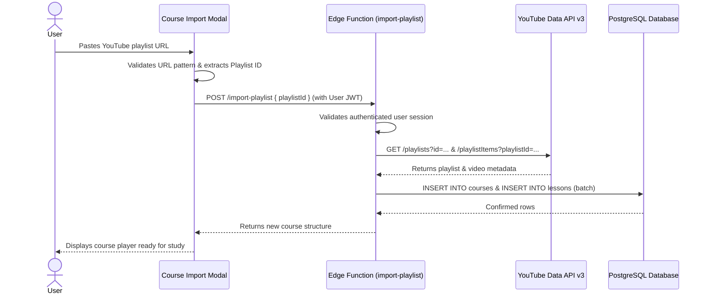
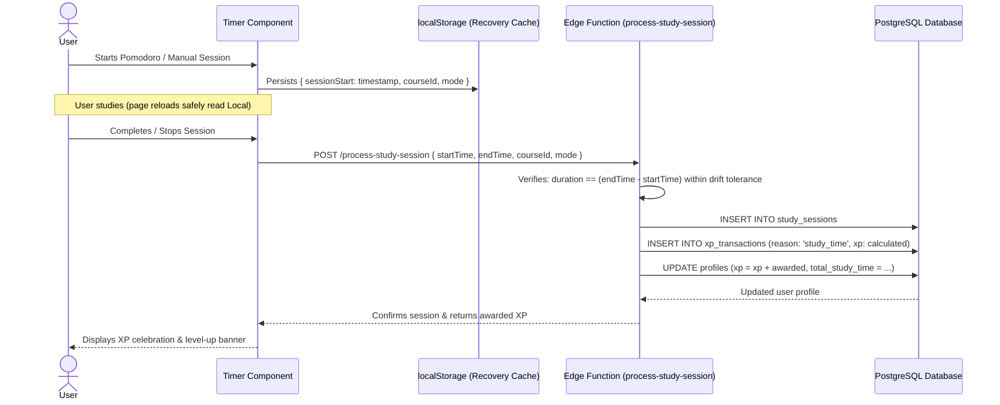

# System Architecture & Technical Design — NexHack

**Project:** NexHack — Gamified Learning & Accountability Platform  
**Target:** Hackathon MVP (Version 1)  
**Status:** Approved Baseline Architecture  
**Author:** Lead Software Architect  

---

## 1. System Overview & Architecture Diagram

NexHack is a decoupled, modern web application designed for learning accountability. It bridges external educational video content (YouTube playlists) with an internal relational persistence and gamification engine hosted on Supabase (PostgreSQL, Row Level Security, Auth, and Edge Functions).

---

## 2. Core Architecture Layers

### 2.1 Presentation & Feature Layer (`src/features/`)
The frontend follows a strictly modular, feature-based architecture to avoid monolith bloat (`App.jsx` remaining purely routing/context scaffolding). Each feature encapsulates its own pages, UI components, and business service:

- **`features/auth/`**: Authentication state management, ProtectedRoute guard, login/sign-up forms.
- **`features/dashboard/`**: High-level learning command center aggregating active courses, quick timer launcher, daily streak, and recent activity.
- **`features/courses/`**: Playlist URL importer modal, course catalog, course player (lesson list, progress bar, embedded player), lesson completion toggle.
- **`features/timer/`**: Dual-mode study timer (Manual stopwatch + Pomodoro), background duration calculation, refresh/crash recovery from `localStorage`, course-tagging, session completion submission.
- **`features/gamification/`**: User level badge, XP progress bar, streak flames, achievement showcase modal.
- **`features/groups/`**: Public group browse/search, private group creation with unique 6-character invite code generation, member roster, group-scoped leaderboards.
- **`features/leaderboard/`**: Tri-metric ranking views (XP, Study Time, Lessons Completed) filtered by timeframe (Weekly, Monthly, Lifetime), with global and group scopes.
- **`features/insights/`**: Comprehensive analytics dashboard (study hours by date, lesson velocity, XP timeline, Recharts visualizations).
- **`features/profile/`**: User account overview, lifetime achievements, enrolled courses, total study time.

### 2.2 Data Access & Service Layer (`src/lib/` & `*Service.js`)
- **`src/lib/supabase.js`**: Initializes the singleton Supabase client using environment variables (`VITE_SUPABASE_URL`, `VITE_SUPABASE_PUBLISHABLE_KEY`).
- **Feature Services (`authService.js`, `courseService.js`, etc.)**: Encapsulate all database queries, remote RPC calls, and Edge Function requests. UI components NEVER execute raw database queries directly.
- **Graceful Mock Fallback Mode**: When Supabase credentials are not yet configured or when developing offline, services seamlessly fall back to deterministic local mock storage (`localStorage` fixtures) so development, UI review, and layout testing remain unblocked.

### 2.3 Backend & Infrastructure Layer (`supabase/`)
- **Supabase Authentication**: Manages user identity, password hashing, and issuance of cryptographically signed JWTs.
- **PostgreSQL Database**: Relational schema enforcing referential integrity (foreign keys, cascading deletes, unique constraints).
- **Row Level Security (RLS)**: PostgreSQL-level access control policies ensuring users can only read/write their own records, and private groups are only visible to confirmed members.
- **Edge Functions (`supabase/functions/`)**:
  - `import-playlist`: Server-side YouTube API proxy that extracts playlist title, thumbnails, video IDs, titles, and durations using the securely stored `YOUTUBE_API_KEY`.
  - `award-xp`: Server-verified XP transaction issuer that prevents duplicate lesson rewards and validates session time bounds before writing to `xp_transactions`.

---

## 3. Request & Data Flows

### 3.1 Course Import Flow

### 3.2 Verified Study Session & XP Award Flow

---

## 4. Key Design Patterns Applied

1. **Repository / Service Pattern**: All data communication is isolated behind service abstractions (`authService`, `courseService`, `timerService`), ensuring UI components remain pure and decoupled from data storage implementation details.
2. **Immutable Transaction Ledger**: Gamification XP is never updated via arbitrary in-place increment queries. Every XP point is an individual row in `xp_transactions`, allowing aggregate reconstruction and auditability.
3. **Session Recovery Pattern**: Study timers store absolute wall-clock start timestamps in browser `localStorage`. Elapsed time is computed as `Math.floor((Date.now() - startTime) / 1000)` rather than relying on unreliable `setInterval` ticks.
4. **Least Privilege & Zero-Trust Client**: Client submissions of XP amounts or direct role modifications are rejected. Calculations are verified server-side.
