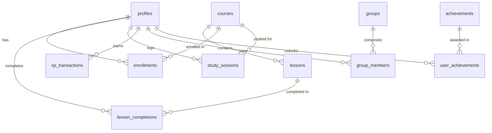

# Database Architecture & Entity Specifications — NexHack

**Database:** PostgreSQL 15+ (via Supabase)  
**Security Model:** Row Level Security (RLS) on all user-facing tables  
**Integrity Strategy:** Relational normalization with foreign key cascading and unique constraint deduplication  

---

## 1. Entity-Relationship Model



---

## 2. Table Schemas & Specifications

### 2.1 `profiles`
Extends `auth.users` with gamification and public profile metadata.
```sql
CREATE TABLE profiles (
    id UUID PRIMARY KEY REFERENCES auth.users(id) ON DELETE CASCADE,
    username TEXT UNIQUE NOT NULL,
    display_name TEXT,
    avatar_url TEXT,
    bio TEXT,
    xp INTEGER NOT NULL DEFAULT 0 CHECK (xp >= 0),
    level INTEGER NOT NULL DEFAULT 1 CHECK (level >= 1),
    current_streak INTEGER NOT NULL DEFAULT 0 CHECK (current_streak >= 0),
    longest_streak INTEGER NOT NULL DEFAULT 0 CHECK (longest_streak >= 0),
    last_active_date DATE,
    total_study_time INTEGER NOT NULL DEFAULT 0 CHECK (total_study_time >= 0), -- in seconds
    created_at TIMESTAMPTZ NOT NULL DEFAULT NOW(),
    updated_at TIMESTAMPTZ NOT NULL DEFAULT NOW()
);
CREATE INDEX idx_profiles_xp ON profiles(xp DESC);
CREATE INDEX idx_profiles_study_time ON profiles(total_study_time DESC);
```

### 2.2 `courses`
Tracks imported educational courses converted from YouTube playlists.
```sql
CREATE TABLE courses (
    id UUID PRIMARY KEY DEFAULT gen_random_uuid(),
    youtube_playlist_id TEXT UNIQUE NOT NULL,
    title TEXT NOT NULL,
    description TEXT,
    thumbnail_url TEXT,
    channel_title TEXT,
    total_lessons INTEGER NOT NULL DEFAULT 0,
    created_by UUID REFERENCES profiles(id) ON DELETE SET NULL,
    created_at TIMESTAMPTZ NOT NULL DEFAULT NOW(),
    updated_at TIMESTAMPTZ NOT NULL DEFAULT NOW()
);
CREATE INDEX idx_courses_playlist_id ON courses(youtube_playlist_id);
```

### 2.3 `lessons`
Individual video lessons comprising a course.
```sql
CREATE TABLE lessons (
    id UUID PRIMARY KEY DEFAULT gen_random_uuid(),
    course_id UUID NOT NULL REFERENCES courses(id) ON DELETE CASCADE,
    youtube_video_id TEXT NOT NULL,
    title TEXT NOT NULL,
    description TEXT,
    thumbnail_url TEXT,
    duration_seconds INTEGER NOT NULL DEFAULT 0,
    position INTEGER NOT NULL, -- 1-based order in playlist
    created_at TIMESTAMPTZ NOT NULL DEFAULT NOW(),
    UNIQUE(course_id, position),
    UNIQUE(course_id, youtube_video_id)
);
CREATE INDEX idx_lessons_course_pos ON lessons(course_id, position ASC);
```

### 2.4 `enrollments`
Tracks user enrollment in a course.
```sql
CREATE TABLE enrollments (
    id UUID PRIMARY KEY DEFAULT gen_random_uuid(),
    user_id UUID NOT NULL REFERENCES profiles(id) ON DELETE CASCADE,
    course_id UUID NOT NULL REFERENCES courses(id) ON DELETE CASCADE,
    enrolled_at TIMESTAMPTZ NOT NULL DEFAULT NOW(),
    completed_at TIMESTAMPTZ,
    UNIQUE(user_id, course_id)
);
CREATE INDEX idx_enrollments_user ON enrollments(user_id);
```

### 2.5 `lesson_completions`
Prevents duplicate lesson rewards and records completion timestamp.
```sql
CREATE TABLE lesson_completions (
    id UUID PRIMARY KEY DEFAULT gen_random_uuid(),
    user_id UUID NOT NULL REFERENCES profiles(id) ON DELETE CASCADE,
    lesson_id UUID NOT NULL REFERENCES lessons(id) ON DELETE CASCADE,
    completed_at TIMESTAMPTZ NOT NULL DEFAULT NOW(),
    UNIQUE(user_id, lesson_id)
);
CREATE INDEX idx_completions_user ON lesson_completions(user_id);
CREATE INDEX idx_completions_lesson ON lesson_completions(lesson_id);
```

### 2.6 `study_sessions`
Chronological study history recorded from Manual and Pomodoro timer intervals.
```sql
CREATE TABLE study_sessions (
    id UUID PRIMARY KEY DEFAULT gen_random_uuid(),
    user_id UUID NOT NULL REFERENCES profiles(id) ON DELETE CASCADE,
    course_id UUID REFERENCES courses(id) ON DELETE SET NULL,
    start_time TIMESTAMPTZ NOT NULL,
    end_time TIMESTAMPTZ NOT NULL,
    duration_seconds INTEGER NOT NULL CHECK (duration_seconds > 0),
    timer_mode TEXT NOT NULL CHECK (timer_mode IN ('manual', 'pomodoro')),
    status TEXT NOT NULL DEFAULT 'completed' CHECK (status IN ('completed', 'abandoned')),
    created_at TIMESTAMPTZ NOT NULL DEFAULT NOW()
);
CREATE INDEX idx_study_sessions_user_date ON study_sessions(user_id, created_at DESC);
```

### 2.7 `xp_transactions`
Immutable ledger recording every XP award for full auditability and leaderboard verification.
```sql
CREATE TABLE xp_transactions (
    id UUID PRIMARY KEY DEFAULT gen_random_uuid(),
    user_id UUID NOT NULL REFERENCES profiles(id) ON DELETE CASCADE,
    amount INTEGER NOT NULL CHECK (amount > 0),
    reason TEXT NOT NULL CHECK (reason IN ('lesson_completion', 'study_time', 'streak_bonus', 'course_completion', 'badge_unlock')),
    related_lesson_id UUID REFERENCES lessons(id) ON DELETE SET NULL,
    related_session_id UUID REFERENCES study_sessions(id) ON DELETE SET NULL,
    created_at TIMESTAMPTZ NOT NULL DEFAULT NOW()
);
CREATE INDEX idx_xp_user_date ON xp_transactions(user_id, created_at DESC);
CREATE INDEX idx_xp_reason ON xp_transactions(reason);
```

### 2.8 `groups`
Social study groups for collaborative accountability and peer rankings.
```sql
CREATE TABLE groups (
    id UUID PRIMARY KEY DEFAULT gen_random_uuid(),
    name TEXT NOT NULL,
    description TEXT,
    avatar_url TEXT,
    is_private BOOLEAN NOT NULL DEFAULT FALSE,
    invite_code TEXT UNIQUE, -- 6-character alphanumeric code for private groups
    created_by UUID REFERENCES profiles(id) ON DELETE SET NULL,
    created_at TIMESTAMPTZ NOT NULL DEFAULT NOW()
);
CREATE INDEX idx_groups_invite_code ON groups(invite_code);
CREATE INDEX idx_groups_public ON groups(is_private) WHERE is_private = FALSE;
```

### 2.9 `group_members`
Maps users to groups with permission roles.
```sql
CREATE TABLE group_members (
    id UUID PRIMARY KEY DEFAULT gen_random_uuid(),
    group_id UUID NOT NULL REFERENCES groups(id) ON DELETE CASCADE,
    user_id UUID NOT NULL REFERENCES profiles(id) ON DELETE CASCADE,
    role TEXT NOT NULL DEFAULT 'member' CHECK (role IN ('owner', 'admin', 'member')),
    joined_at TIMESTAMPTZ NOT NULL DEFAULT NOW(),
    UNIQUE(group_id, user_id)
);
CREATE INDEX idx_group_members_group ON group_members(group_id);
CREATE INDEX idx_group_members_user ON group_members(user_id);
```

### 2.10 `achievements` & `user_achievements`
Static milestone definitions and user unlock history.
```sql
CREATE TABLE achievements (
    id TEXT PRIMARY KEY, -- e.g. 'first_step', 'marathoner', 'streak_7', 'polymath'
    title TEXT NOT NULL,
    description TEXT NOT NULL,
    icon_name TEXT NOT NULL,
    xp_reward INTEGER NOT NULL DEFAULT 50,
    created_at TIMESTAMPTZ NOT NULL DEFAULT NOW()
);

CREATE TABLE user_achievements (
    id UUID PRIMARY KEY DEFAULT gen_random_uuid(),
    user_id UUID NOT NULL REFERENCES profiles(id) ON DELETE CASCADE,
    achievement_id TEXT NOT NULL REFERENCES achievements(id) ON DELETE CASCADE,
    unlocked_at TIMESTAMPTZ NOT NULL DEFAULT NOW(),
    UNIQUE(user_id, achievement_id)
);
CREATE INDEX idx_user_achievements_user ON user_achievements(user_id);
```

---

## 3. Row Level Security (RLS) Policies

All tables enable RLS (`ALTER TABLE <table> ENABLE ROW LEVEL SECURITY;`).

1. **`profiles`:**
   - SELECT: Public (`true`) — users can view other members' leaderboard stats and profiles.
   - UPDATE: Only user can update their own row (`auth.uid() = id`).
2. **`courses` & `lessons`:**
   - SELECT: Public (`true`) — all authenticated users can view imported courses.
   - INSERT/UPDATE: Authenticated users can insert imported courses.
3. **`enrollments` & `lesson_completions`:**
   - SELECT: User can read their own completions (`auth.uid() = user_id`).
   - INSERT: User can only insert rows for themselves (`auth.uid() = user_id`).
4. **`study_sessions` & `xp_transactions`:**
   - SELECT: User can read their own records (`auth.uid() = user_id`).
   - INSERT: Protected via Edge Function or strict check (`auth.uid() = user_id`).
5. **`groups`:**
   - SELECT: Public groups (`is_private = false`) are readable by all. Private groups are only readable if the user is a confirmed member in `group_members`.
6. **`group_members`:**
   - SELECT: Readable by members of the group.
   - INSERT: Authenticated users can join public groups, or private groups if supplying matching `invite_code`.
